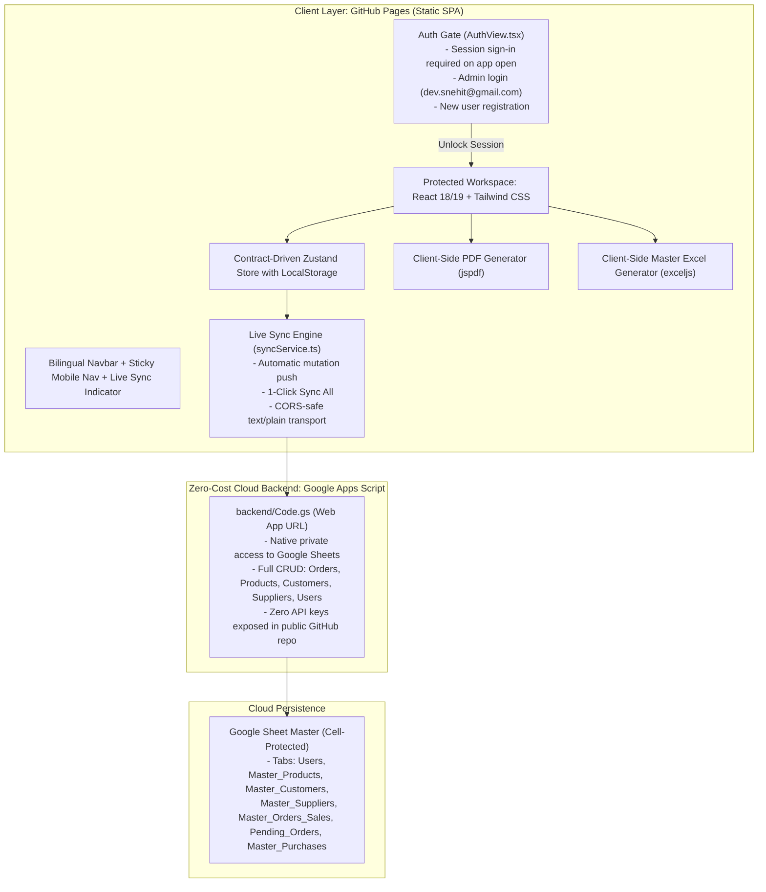

# Katha Wholesale – Master Implementation Plan
**Application:** Katha Wholesale (కథా హోల్‌సేల్) – Enterprise Rice & Groceries Wholesale Platform  
**Architecture:** Static Single-Page App on GitHub Pages + Google Apps Script Web App Backend  
**Deployment Cost:** $0.00 (Free Forever)  
**Status:** IMPLEMENTED & ACTIVE  

---

## 1. System Overview & Core Requirements

Katha Wholesale is a specialized web application engineered for wholesale commodity merchants trading in Rice, Flours (Wheat Ravva, Suji Ravva, Maida), and Groceries. It runs 100% free on **GitHub Pages**, synchronizes with a **Master Google Sheet** via Google Apps Script, and features a high-end mobile-first UI.

### Key Functional Pillars:
1. **Zero Dummy/Sample Data**: Starts 100% clean with zero mock commodities, customers, suppliers, or orders. All data entered by the user is real and persists locally via `localStorage` and remotely in Google Sheets.
2. **Pre-Seeded Master Administrator**: Root administrator account pre-configured for **Snehit Tadepalli** (`dev.snehit@gmail.com`, Role: `ADMIN`, Status: `APPROVED`).
3. **Session Authentication & Admin Sign-In Requirement**: Every time the application is opened, users (including root Admin Snehit Tadepalli) must sign in via a dedicated mobile-first Sign In / Register screen (`AuthView.tsx`) to unlock access. A prominent Sign Out button allows locking the session immediately.
4. **User Registration & Admin Approval Gate**: New users register with their Full Name, Email, 10-digit Mobile, Desired Role, and Password. Accounts remain in `PENDING_APPROVAL` until Admin Snehit Tadepalli approves or denies them in the Admin Portal.
5. **Real-Time Google Sheets Two-Way Synchronization**: Live background synchronization engine (`src/lib/syncService.ts`) connects transactions directly to Google Apps Script (`backend/Code.gs`). Automatically pushes orders, stock changes, customers, and suppliers to Google Sheets without CORS preflight failures, with real-time sync status badges (🟢 Synced / 🟡 Syncing / 🔴 Error / ⚪ Unlinked) and manual 1-click "Sync All".
6. **Dynamic Multi-Item Order Builder (`+ Add Item`)**: Allows orders and sales to contain multiple commodity line items at different quantities in a single bill, with dynamic calculation of bags, metric weight in kg, hamali, and freight.
7. **Mobile-First CRM / Pipeline UI**: Inspired by modern pipeline interfaces (coral-orange accents `#FF5A36`, multi-segment progress strip, 2-letter pastel avatar badges, and a sticky mobile bottom navigation bar).
8. **Zero Native Alerts (`AlertDialog.tsx`)**: Completely eliminated browser `alert()` and `confirm()` dialogs in favor of a sleek, accessible, responsive modal dialog supporting `info`, `success`, `warning`, `danger`, and `confirm` types.
9. **Two-Stage Stock Reservation**: Stock is marked `RESERVED` upon order creation to prevent overselling on the shop floor; permanently `DEDUCTED` when the Owner approves.
10. **Bilingual Engine (English & Telugu)**: Full interface toggling between English and **తెలుగు** with automatic English fallback (`item.nameTe || item.name`).
11. **Customer & Supplier Directories**: Mandatory 10-digit mobile number with 1-click WhatsApp (`wa.me`) billing, plus supplier bank account details and reference nicknames.
12. **Three Date & Date-Range PDF Exports**: Daily/Period Sales Report, Item-Wise Number Tally (`1 + 4 + 5 = 10 Bags`), and Closing Stock Position Report.
13. **Client-Side Master Excel Generator**: In-browser export of `master_records.xlsx` with formula cells protected.

---

## 2. Technical Architecture & Tech Stack



* **Frontend**: React 18/19, TypeScript, Tailwind CSS, Lucide Icons, Framer Motion.
* **Authentication Gate**: Full-screen mobile-first `AuthView.tsx` requiring credentials every time the app opens.
* **Sync Engine**: `src/lib/syncService.ts` providing automatic background push and manual sync to Google Sheets.
* **Build Tool**: Vite v6.
* **Testing**: Vitest + React Testing Library (22 tests passing across 5 suites).
* **Backend**: Google Apps Script (`backend/Code.gs`) deployed as a Web App URL.
* **CI/CD**: GitHub Actions workflow (`.github/workflows/deploy.yml`) deploying automatically to GitHub Pages.

---

## 3. Data Contracts & Domain Models (`src/contracts/index.ts`)

All entities are strictly validated via **Zod schemas**:

### A. Customer Contract
* `id`: UUID string
* `name`: String (Mandatory)
* `nameTe`: String (Optional Telugu name)
* `phone`: 10-digit Indian mobile number (`^[6-9]\d{9}$`)
* `businessName`: String (Optional)
* `address`: String (Optional)
* `currentDue`: Number (Default: 0)

### B. Product / Commodity Contract
* `id`: UUID string
* `name`: String (English - Mandatory)
* `nameTe`: String (Optional Telugu name)
* `category`: `'RICE' | 'BROKEN_RICE' | 'SUJI_RAVVA' | 'WHEAT_RAVVA' | 'MAIDA' | 'ATTA' | 'OTHER'`
* `brandOrMill`: String (Optional)
* `innerBagWeightKg`: Number (e.g. 1.0 kg)
* `innerBagsPerOuter`: Number (e.g. 25 inner packets per outer bag)
* `outerBagTotalKg`: Number (`innerBagWeightKg * innerBagsPerOuter`)
* `stockPhysicalOuter`: Number (Physical bags in warehouse)
* `stockReservedOuter`: Number (Reserved for pending orders)
* `stockLooseInner`: Number (Opened loose packets)
* `wholesalePriceBag`: Number (Wholesale price per outer bag)
* `pricePerInnerBag`: Number (Price per inner packet)

### C. Order Contract (Multi-Item Support)
* `id`: UUID string
* `orderNumber`: String (e.g. `ORD-1042`)
* `customerId`: String
* `customerName`: String
* `customerPhone`: String
* `orderDate`: ISO Date string
* `status`: `'PENDING_REVIEW' | 'APPROVED' | 'PACKED' | 'DISPATCHED' | 'DELIVERED' | 'CANCELLED'`
* `totalOuterBags`: Number
* `totalWeightKg`: Number
* `items`: Array of Order Items:
  - `productId`: String
  - `productName`: String
  - `unitType`: `'OUTER_BAG' | 'INNER_BAG' | 'LOOSE_KG'`
  - `quantity`: Number
  - `unitPrice`: Number
  - `lineTotal`: Number
* `subtotal`: Number
* `hamaliCharges`: Number (Total bags &times; Hamali rate)
* `transportCharges`: Number (Freight)
* `grandTotal`: Number
* `paymentMode`: `'CASH' | 'CREDIT' | 'UPI' | 'CHEQUE'`
* `vehicleNumber`: String (Optional)
* `driverPhone`: String (Optional)

---

## 4. Mobile-First UI/UX & Color Scheme

Inspired by the provided reference pipeline design:
* **Brand Primary**: Coral Orange (`#FF5A36` to `#FF6B4A`) with glowing button shadows.
* **Canvas Background**: Soft Warm Neutral (`#F8F9FB`).
* **Card Containers**: Rounded 24px cards (`card-soft`) with ultra-diffused shadow and subtle borders.
* **Pipeline Progress Bar**: Top segmented color strip displaying:
  - 🔵 **Pending Review**
  - 🟡 **Packing**
  - 🟣 **In Transit**
  - 🟢 **Delivered**
* **Initials Badges**: 2-letter customer initials in rounded-xl pastel badges (`RM`, `KS`, `OS`, `SB`).
* **Sticky Mobile Bottom Navigation**: Fixed thumb-reachable navigation bar for mobile devices:
  - `Orders` (with live pending badge counter)
  - `Stock`
  - `Clients`
  - `Mills`
  - `Reports`

---

## 5. Google Sheets Two-Way Live Sync Engine & Auth Gate

### A. Live Google Sheets Background Sync (`src/lib/syncService.ts`)
* **CORS-Safe Payload Transport**: Uses `fetch(backendUrl, { method: 'POST', redirect: 'follow', headers: { 'Content-Type': 'text/plain;charset=utf-8' }, body: JSON.stringify(...) })`. This bypasses browser preflight issues with Google Apps Script Web Apps.
* **Auto-Push on Mutation**: Store actions automatically dispatch mutation events to Google Sheets:
  - `saveOrder`: Records new orders in `Pending_Orders` or `Master_Orders_Sales`.
  - `updateOrderStatus`: Updates order status (e.g. from Pending to Approved/Delivered).
  - `saveCustomer`: Persists Kirana customers and dues to `Master_Customers`.
  - `saveSupplier`: Persists Rice mills & bank details to `Master_Suppliers`.
  - `saveProduct`: Synchronizes inventory balances to `Master_Products`.
  - `syncAll`: Batches full local state to remote sheet tabs in 1-tap.
* **Real-time Header Sync Pill**:
  - 🟢 **Synced with Google Sheet** (shows time of last successful sync).
  - 🟡 **Syncing...** (shows active spinner during network transfer).
  - 🔴 **Sync Error** (displays failure reason with retry button).
  - ⚪ **Link Google Sheet** (direct link to configure Web App URL in settings).
* **Settings Modal Live Ping**: Includes a "Test Connection" button that runs `ping` to verify Google Sheet connectivity before saving.

### B. Mobile-First Auth Gate & Session Security (`AuthView.tsx`)
* **Session Guard**: Every time the application is opened, `isAuthenticated` defaults to `false`. Users must explicitly authenticate to enter the application.
* **Admin Sign-In**: Root Administrator **Snehit Tadepalli** (`dev.snehit@gmail.com`, default passcode: `admin`) logs in to unlock the platform.
* **User Registration & Approval Flow**:
  - New staff/users submit: Full Name, Email, 10-Digit Mobile, Desired Role, and Password.
  - Accounts are set to `status: 'PENDING_APPROVAL'` and registered in both local storage and the Google Sheet `Users` tab.
  - Non-approved users are prevented from entering and presented with a status message prompting them to contact Admin Snehit Tadepalli.
  - Admin approves or denies access from the `User Requests` tab.
* **Sign Out**: Prominently accessible in the top navigation bar, clearing the active session and returning to the login gate.

---

## 6. Verification & Testing

Every core engine is verified with automated tests in `tests/`:
* `packagingEngine.test.ts`: Outer bag calculation, net weight, and auto-unbundling math.
* `stockEngine.test.ts`: Two-stage reservation, overselling prevention, commitment, and release.
* `tallyEngine.test.ts`: Single-day arithmetic string (`1 + 4 + 5 = 10 Bags`) and date-range grouping.
* `bilingualHelper.test.ts`: Telugu text display with graceful English fallback.
* `contracts.test.ts`: Zod schema validation for 10-digit mobile, IFSC codes, and pre-seeded admin.

**Test Run Output:**
```
 Test Files  5 passed (5)
      Tests  22 passed (22)
```

---

## 7. Living Documentation Files in Repository

1. **`docs/IMPLEMENTATION_PLAN.md`**: This document (architectural blueprint, data models, and UI mapping).
2. **`docs/REQUIREMENTS_SPEC.md`**: Master Gherkin User Stories (US-1 to US-9) and executable specifications.
3. **`docs/SETUP_GUIDE.md`**: Plain-English onboarding manual for Google Sheets, Apps Script, and GitHub Pages setup.
