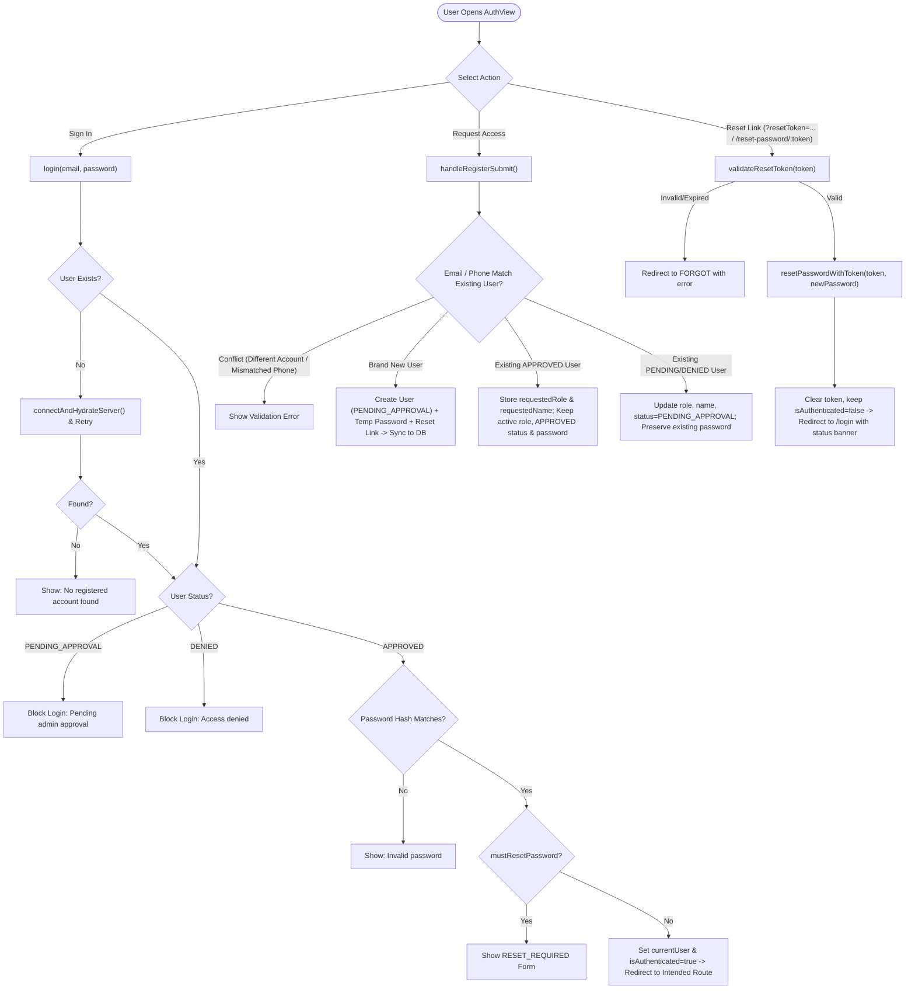
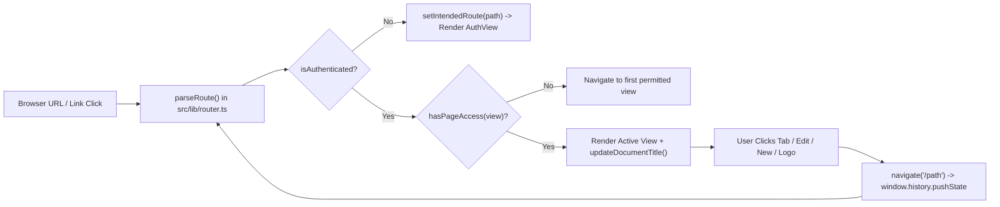
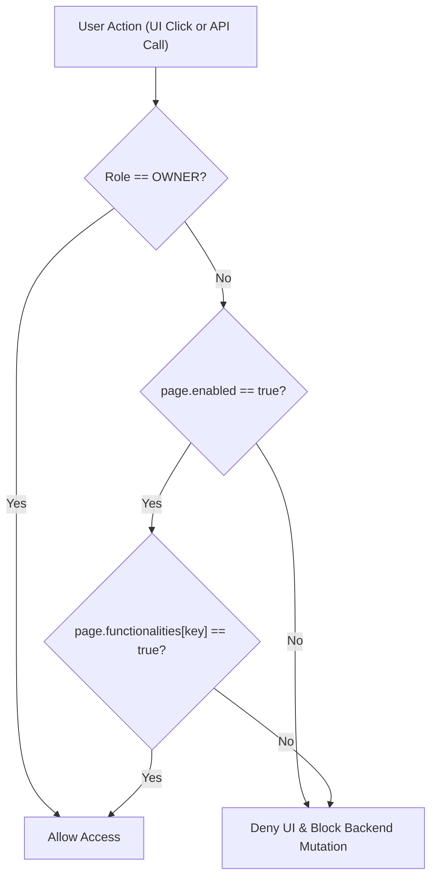
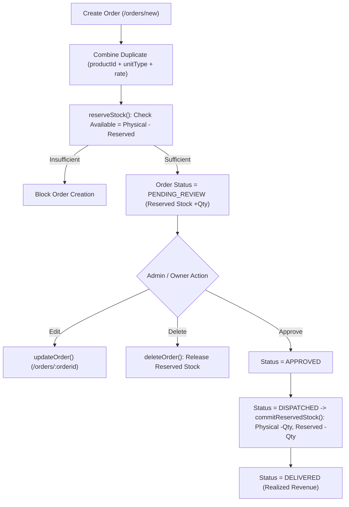
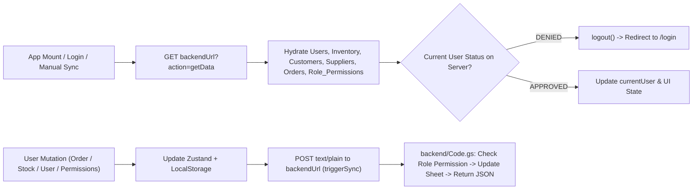

# Kaatha Wholesale — Modules, Functionalities & Flowcharts

> **Maintenance Rule:** Any code change to a module listed below **must** be accompanied by an update to the corresponding section and flowchart in this document.

---

## 1. Authentication, Registration, Password Reset & Role Re-Request

**Files:** `src/components/auth/AuthView.tsx`, `src/store/useAppStore.ts`, `src/lib/crypto.ts`, `src/contracts/index.ts`, `backend/Code.gs`

### Capabilities
- **Session Gate:** All protected routes require `isAuthenticated && currentUser` persisted in `localStorage` (`katha_wholesale_currentUser`) until explicit logout.
- **SHA-256 Password Hashing:** All passwords are hashed client-side using Web Crypto (`hashPassword()` in `src/lib/crypto.ts`).
- **New User Registration (`Request Access`):**
  - Validates Full Name (min 2 chars), Email, and 10-digit Indian mobile number (`^[6-9]\d{9}$`).
  - Generates a temporary password (`generateTemporaryPassword()`), SHA-256 hash, and a unique 24-hour password setup token/link (`resetToken`).
  - Stores user with `status: 'PENDING_APPROVAL'` and dispatches email via `backend/Code.gs`.
  - **Approval Gate:** Pending users cannot sign in until an administrator approves their request.
- **Password Reset via Link (`?resetToken=...` or `/reset-password/:token`):**
  - `validateResetToken()` checks token existence and expiry (`resetPasswordExpires`).
  - `resetPasswordWithToken()` updates `passwordHash`, clears the token, **does not auto-login**, and redirects the user to `/login` with a status banner (informing `PENDING_APPROVAL` users to wait for admin approval).
- **Existing User Role Re-Request (Without Changing Password):**
  - Entering the same registered email and mobile number in the `Request Access` form allows updating Full Name and requesting a different role **without modifying the existing password**.
  - **Existing `APPROVED` users:** Active `role` and `status: 'APPROVED'` are preserved; `requestedRole` and `requestedName` are stored so the user continues logging in with existing privileges until an administrator approves the change.
  - **Existing `PENDING_APPROVAL` / `DENIED` users:** Updates `role`, `name`, and sets `status: 'PENDING_APPROVAL'` while preserving existing password/tokens.
  - Mismatched email/mobile combinations are rejected.

### Flowchart

---

## 2. Slash Routing & Responsive Navigation

**Files:** `src/lib/router.ts`, `src/App.tsx`, `src/components/Navbar.tsx`

### Capabilities
- **History API Slash Routing (Zero `#` Hash Routing):** Supports bookmarkable URLs and parameter routes:
  - `/dashboard`, `/orders`, `/orders/new`, `/orders/:orderid`
  - `/stock`, `/stock/new`, `/stock/:productid`
  - `/customers`, `/customers/new`, `/customers/:customerid`
  - `/suppliers`, `/suppliers/new`, `/suppliers/:supplierid`
  - `/exports`, `/admin`, `/admin/new-user`, `/settings`
  - `/login`, `/register`, `/forgot-password`, `/reset-password/:token`
- **Intended Route Preservation:** Unauthenticated visits to deep links save `katha_intended_route` in `sessionStorage` and redirect back after sign-in.
- **Role Route Guard:** Automatically redirects users away from views disabled in their role's permissions JSON.
- **Responsive Top & Mobile Navigation (`Navbar.tsx`):**
  - Clickable `Kaatha` / `కాతా CRM` brand logo routes to the user's landing page (`/dashboard` or `/orders`).
  - **Desktop (`>= 1024px`):** Single-row header with concise pill tabs (`Dashboard`, `Orders`, `Stock`, `Customers`, `Suppliers`, `Reports`, `Admin`) + tooltips, pending order badge, sync status pill, settings, language switcher, user role badge, and sign-out confirmation.
  - **Tablets & Mobile (`< 1024px`):** Dedicated sticky top horizontal navigation pill rail directly below the brand row so all options remain visible at the top of the screen, plus a synchronized mobile bottom bar (`md:hidden`) for thumb reach.

### Flowchart

---

## 3. Role-Based Permissions & User Management

**Files:** `src/config/roles/roles.json`, `src/config/roles/owner.json`, `admin.json`, `staff.json`, `customer.json`, `src/lib/permissions.ts`, `src/components/admin/RolePermissionsManager.tsx`, `src/components/admin/UserRequestsView.tsx`, `backend/Code.gs`

### Capabilities
- **Externalized Role JSON Configs:** Default permissions for `OWNER`, `ADMIN`, `STAFF`, and `CUSTOMER` live in `src/config/roles/*.json` and are loaded into `DEFAULT_ROLE_PERMISSIONS` via `src/lib/permissions.ts`.
- **Dual-Layer Enforcement:**
  - **Frontend:** `hasPageAccess(pageKey)` and `hasFunctionalityAccess(pageKey, funcKey)` control navigation tabs, views, buttons, and dashboard widgets.
  - **Backend (`Code.gs`):** `checkBackendPermission(ss, userRole, pageKey, funcKey)` enforces the `Role_Permissions` sheet rules on server mutations (`saveOrder`, `deleteOrder`, `saveProduct`, `deleteProduct`, `saveCustomer`, `deleteCustomer`, `saveSupplier`, `deleteSupplier`, `createUser`, `approveUser`, `updateUser`, `deleteUser`, `updateRolePermissions`).
- **Role Specific Controls UI (`RolePermissionsManager.tsx`):** Allows Admin/Owner to toggle page-level and functionality-level booleans per role and persist to the `Role_Permissions` sheet.
- **User Management (`UserRequestsView.tsx`):**
  - **Pending Approval Requests:** Lists both `PENDING_APPROVAL` registrations and `APPROVED` users with a pending `requestedRole` / `requestedName`. Approving applies `requestedRole` and `requestedName`; denying a role-change request clears the request while preserving existing active privileges.
  - **Create User (`/admin/new-user`):** Directly creates an `APPROVED` user in the database with a temporary password and password-setup link emailed via `MailApp`.
  - **Active System Users:** Inline edit (`name`, `role`, `status`) and delete with `AlertDialog` confirmation.

### Flowchart

---

## 4. Business Performance Dashboard

**Files:** `src/components/dashboard/DashboardView.tsx`

### Capabilities
All dashboard sections are individually gated by `dashboard_page` functionalities in the role JSON:
- `view_dashboard`: Overall dashboard access.
- `view_kpi_metrics`: Pipeline turnover, realized delivered revenue, pending pipeline value, outstanding customer credit dues, and today's sales summary.
- `view_order_funnel_chart`: Interactive stage distribution across `PENDING_REVIEW`, `APPROVED`, `DISPATCHED`, and `DELIVERED` (counts, bags, and percentages).
- `view_inventory_health`: Godown physical vs. reserved vs. available bags, loose inner packets, low-stock alerts (`<= 20` available bags), and top commodities bar chart.
- `view_credit_risk_table`: Ranked customer outstanding receivables table.
- `view_recent_activity`: Chronological live activity feed of recent orders.
- `quick_actions`: Direct navigation shortcuts to New Order, Add Stock, Customer Payments, and Exports.

---

## 5. Orders Pipeline, Multi-Item Builder & Two-Stage Stock Reservation

**Files:** `src/components/orders/PendingOrdersView.tsx`, `src/lib/stockEngine.ts`, `src/store/useAppStore.ts`, `backend/Code.gs`

### Capabilities
- **Dynamic Multi-Item Order Builder:** Add multiple commodities (`OUTER_BAG`, `INNER_BAG`, `LOOSE_KG`), editable sale rates, hamali, freight, and custom bill discounts (`₹`).
- **Auto-Combining Duplicate Line Items:** Adding or saving items with the same `productId`, `unitType`, and `ratePerUnit` automatically combines their quantities into a single consolidated line item.
- **Two-Stage Stock Allocation (`stockEngine.ts`):**
  1. **Reservation (`reserveStock`):** On order creation (`PENDING_REVIEW`), `stockReservedOuter` increases for `OUTER_BAG` items so other staff cannot oversell available stock (`stockPhysicalOuter - stockReservedOuter`).
  2. **Commit / Deduction (`commitReservedStock`):** When approved/dispatched, both `stockPhysicalOuter` and `stockReservedOuter` are decremented.
  3. **Restoration on Delete/Cancel:** Deleting or cancelling a `PENDING_REVIEW` order releases `stockReservedOuter`.
- **WhatsApp Bill Sharing:** Generates formatted bilingual order summaries via `wa.me` deep links.
- **Admin/Owner Edit & Delete:** Full edit via `/orders/:orderid` and confirmation-guarded deletion (`deleteOrder`).

### Flowchart

---

## 6. Stock Registry, Packaging & Purchase Validation

**Files:** `src/components/stock/StockRegistryView.tsx`, `src/lib/packagingEngine.ts`, `src/lib/purchaseValidation.ts`, `src/store/useAppStore.ts`

### Capabilities
- **3-Tier Pricing Validation (`validatePurchaseForm`):**
  - Validates commodity name, outer bag weight calculation (`calculateOuterBagWeight = innerBagWeightKg * innerBagsPerOuter`), and enforces `purchasePrice <= wholesalePrice <= retailPrice`.
- **Godown Inventory & Unpacking (`unpackMasterBag`):**
  - Tracks `stockPhysicalOuter`, `stockReservedOuter`, `stockLooseInner`, and `stockLooseKg`.
  - 1-click **Unpack 1 Bag** decrements `stockPhysicalOuter` by 1 and adds `innerBagsPerOuter` to `stockLooseInner`.
- **Add / Edit / Delete:** Routable via `/stock/new` and `/stock/:productid` with confirmation dialogs.

---

## 7. Customer & Supplier Directories

**Files:** `src/components/customers/CustomerDirectoryView.tsx`, `src/components/suppliers/SupplierDirectoryView.tsx`, `src/lib/customerValidation.ts`

### Capabilities
- **Customer Directory (`/customers`, `/customers/new`, `/customers/:customerid`):**
  - Validates alphabetic customer names and unique 10-digit mobile numbers (`validateCustomerForm`).
  - Tracks `currentDue` (credit ledger), bilingual names/addresses, and 1-click WhatsApp contact.
- **Supplier Directory (`/suppliers`, `/suppliers/new`, `/suppliers/:supplierid`):**
  - Tracks mill/supplier business details, owner names, bank account (`bankName`, `accountNo`, `ifscCode`), and reference nicknames.

---

## 8. Exports, PDF Reports & Master Excel Generator

**Files:** `src/components/exports/ExportCenterView.tsx`, `src/lib/pdfGenerator.ts`, `src/lib/excelExport.ts`, `src/lib/tallyEngine.ts`

### Capabilities
- **Date Filtering:** Filter orders by Single Day or Date Range.
- **Three Print-Ready PDF Reports (`jspdf` + `jspdf-autotable`):**
  1. **Sales Report PDF (`generateSalesReportPDF`):** Order-by-order breakdown with totals and discounts.
  2. **Number Tally PDF (`generateNumberTallyPDF` + `tallyEngine.ts`):** Arithmetic loading audit strings (e.g., `1 + 4 + 5 = 10 Bags`).
  3. **Stock Position PDF (`generateStockPositionPDF`):** Closing godown physical, reserved, and available stock.
- **Master Excel Export (`exportMasterExcelFile` via `exceljs`):** Generates multi-sheet `master_records.xlsx` workbook with protected formula cells.

---

## 9. Backend Sync, Settings, Bilingual Engine & UI Standards

**Files:** `src/lib/syncService.ts`, `backend/Code.gs`, `src/components/settings/SettingsModal.tsx`, `src/locales/en.ts`, `src/locales/te.ts`, `src/lib/bilingualHelper.ts`, `src/components/ui/AlertDialog.tsx`, `src/hooks/useModalDismiss.ts`

### Capabilities
- **CORS-Safe Transport (`syncService.ts`):** Sends `POST` requests with `Content-Type: text/plain;charset=utf-8` and `redirect: 'follow'` to Google Apps Script Web App URL to avoid CORS preflight failures.
- **Hydration & Deduplication:** `connectAndHydrateServer()` fetches all sheets (`getData`), normalizes emails/phones, deduplicates user records, and synchronizes active user status/role.
- **Settings & Font Scaling (`SettingsModal.tsx`):** Configure backend webhook URL, test connection (`pingGoogleSheet`), trigger manual 1-click Sync All, and adjust persistent `baseFontSize` (`12px`–`20px`).
- **UI Standards:** Zero native `alert()`/`confirm()` calls (`AlertDialog.tsx`), `Esc` & overlay-click modal dismissal (`useModalDismiss.ts`), full-screen action spinners (`actionLoading`), and strict EN/TE isolation.

### Sync & Hydration Flowchart

