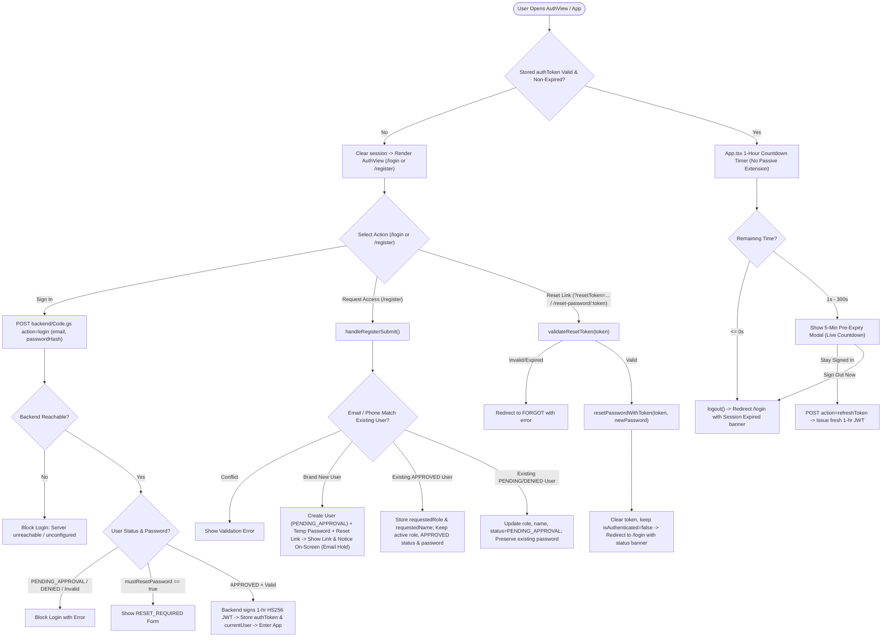
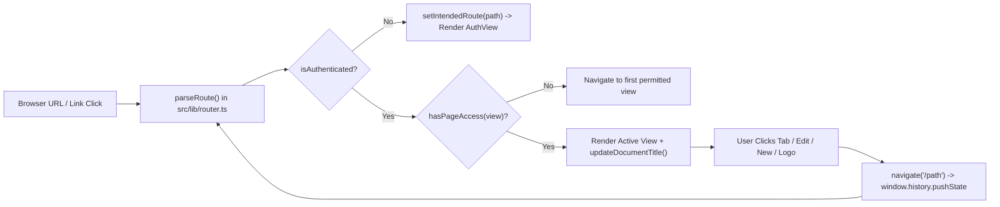
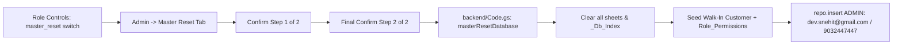
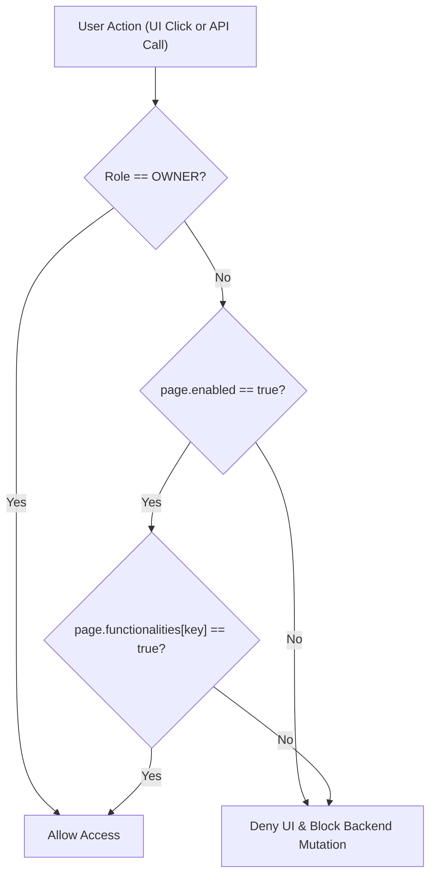
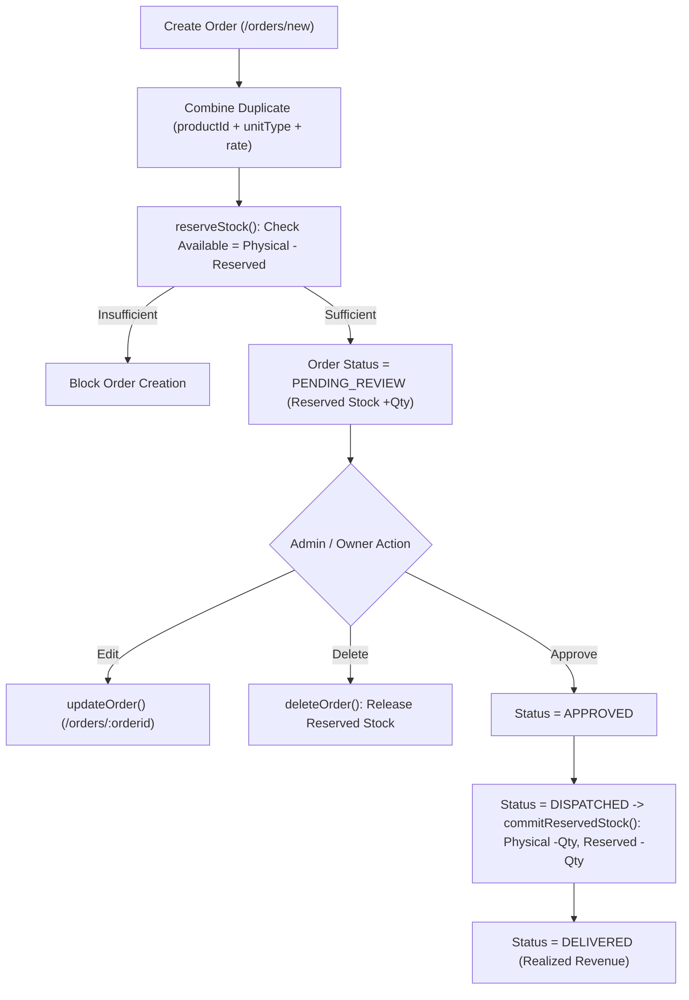
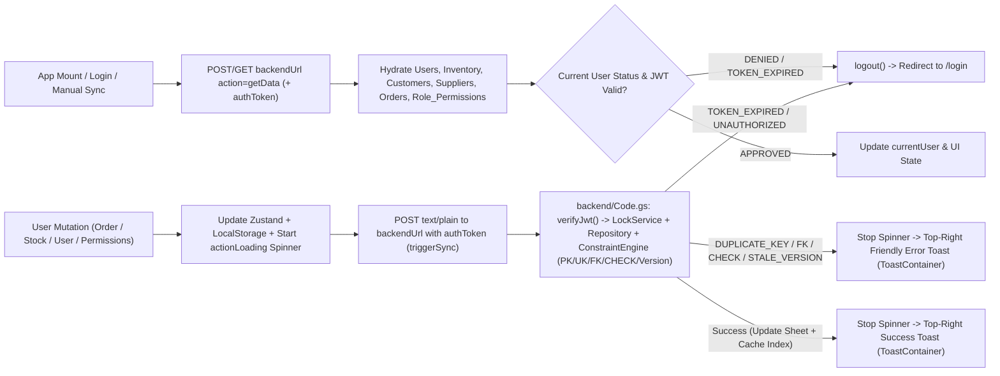
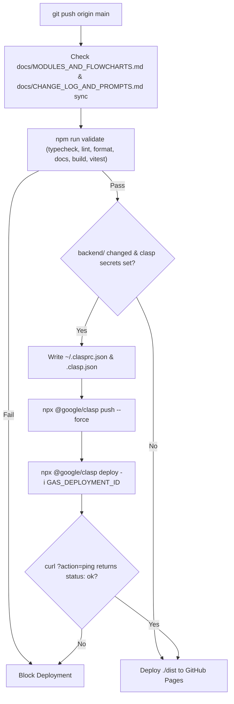

# Kaatha App (Kaatha Wholesale) — Modules, Functionalities & Flowcharts

> **Maintenance Rule:** Any code change to a module listed below **must** be accompanied by an update to the corresponding section and flowchart in this document.
> **Shell & UI Notes:** Branded as **Kaatha App** (`Navbar.tsx`, `router.ts`) with a responsive single-row desktop pill bar (`lg+`), tablet top strip (`md..lg`), and scrollable mobile bottom nav (`< md`), plus a compact viewport-centered `fixed inset-0` `<Loader2>` overlay (`App.tsx`). `PendingOrdersView` supports `orderDate` (default today, past dates allowed); `StockRegistryView` supports selecting `brandOrMill` from the `suppliers` dropdown, optional `billNumber` (Bill/Invoice Number), and `purchaseDate` (default today, past dates allowed).

---

## 1. Authentication, HS256 JWT Session Gate, Password Reset & Role Re-Request

**Files:** `src/components/auth/AuthView.tsx`, `src/store/useAppStore.ts`, `src/lib/crypto.ts`, `src/lib/jwt.ts`, `src/App.tsx`, `src/contracts/index.ts`, `backend/Code.gs`

### Capabilities
- **Strict Backend HS256 JWT Authentication:**
  - `login()` strictly requires the backend API (`backend/Code.gs` `login` action) to validate `email` + SHA-256 `passwordHash` against the `Users` sheet, enforce `status === 'APPROVED'`, and issue an **HS256 JWT** signed with a server-only secret stored in `PropertiesService.getScriptProperties()` (`JWT_SECRET`, auto-generated if missing).
  - The JWT carries `sub`, `email`, `role`, `status`, `iat`, and `exp = iat + 3600` (strict 1-hour expiration).
  - Frontend persists `authToken` (`katha_wholesale_authToken`) alongside `currentUser` in `localStorage`. On app boot and via a 1-second interval in `App.tsx`, `isJwtExpired()` / `getJwtRemainingSeconds()` inspects the `exp` claim.
  - **5-Minute Pre-Expiry Warning & Forced Logout:** Passive mouse/keyboard activity never extends the session. At 5 minutes (`<= 300s`) remaining, `App.tsx` displays a bilingual **Session Expiring Soon** modal with a live `MM:SS` countdown and two choices: **"Stay Signed In"** (calls `refreshSessionToken()` -> backend `refreshToken` action to issue a fresh 1-hour JWT) or **"Sign Out Now"**. Reaching `00:00` or receiving `TOKEN_EXPIRED` / `UNAUTHORIZED` from the backend immediately forces `logout()` and redirects to `/login` with an expiration banner.
- **SHA-256 Password Hashing:** All passwords are hashed client-side using Web Crypto (`hashPassword()` in `src/lib/crypto.ts`).
- **New User Registration (`Request Access`):**
  - Validates Full Name (min 2 chars), Email, and 10-digit Indian mobile number (`^[6-9]\d{9}$`).
  - Generates a temporary password (`generateTemporaryPassword()`), SHA-256 hash, and a unique 24-hour password setup token/link (`resetToken`).
  - Stores user with `status: 'PENDING_APPROVAL'`.
  - **Temporary Email Delivery Hold (`ENABLE_EMAIL_DELIVERY = false` in `backend/Code.gs`):** Outbound `MailApp.sendEmail` calls are temporarily disabled until an SMTP server is configured; the generated password-setup link (`resetLink`) is still created and displayed directly on screen with Copy / Open actions.
  - **Dedicated `/login` & `/register` Routes:** Switching between Sign In and Request Access updates the browser URL (`/login` vs `/register`), and any unauthenticated visit or forced logout automatically redirects to `/login`.
  - **Approval Gate:** Pending users cannot sign in until an administrator approves their request.
- **Password Reset via Link (`?resetToken=...` or `/reset-password/:token`):**
  - `validateResetToken()` checks token existence and expiry (`resetPasswordExpires`).
  - `resetPasswordWithToken()` updates `passwordHash`, clears the token, **does not auto-login**, and redirects the user to `/login` with a status banner (informing `PENDING_APPROVAL` users to wait for admin approval).
- **Existing User Role Re-Request (Without Changing Password):**
  - Entering the same registered email and mobile number in the `Request Access` form allows updating Full Name and requesting a different role **without modifying the existing password**.
  - **Existing `APPROVED` users:** Active `role` and `status: 'APPROVED'` are preserved; `requestedRole` and `requestedName` are stored so the user continues logging in with existing privileges until an administrator approves the change.
  - **Existing `PENDING_APPROVAL` / `DENIED` users:** Updates `role`, `name`, and sets `status: 'PENDING_APPROVAL'` while preserving existing password/tokens.
  - Mismatched email/mobile combinations are rejected.

### Flowchart

---

## 2. Slash Routing & Responsive Navigation

**Files:** `src/lib/router.ts`, `src/App.tsx`, `src/components/Navbar.tsx`

### Capabilities
- **History API Slash Routing (Zero `#` Hash Routing):** Supports bookmarkable URLs and parameter routes:
  - `/dashboard`, `/orders`, `/orders/new`, `/orders/:orderid`
  - `/stock`, `/stock/new`, `/stock/:productid`
  - `/customers`, `/customers/new`, `/customers/:customerid`
  - `/suppliers`, `/suppliers/new`, `/suppliers/:supplierid`
  - `/exports`, `/admin`, `/admin/new-user`, `/settings`
  - `/login`, `/register`, `/forgot-password`, `/reset-password/:token`
- **Intended Route Preservation:** Unauthenticated visits to deep links save `katha_intended_route` in `sessionStorage` and redirect back after sign-in.
- **Role Route Guard:** Automatically redirects users away from views disabled in their role's permissions JSON.
- **Responsive Top & Mobile Navigation (`Navbar.tsx`):**
  - Clickable `Kaatha` / `కాతా CRM` brand logo routes to the user's landing page (`/dashboard` or `/orders`).
  - **Desktop (`>= 1024px`):** Single-row header with concise pill tabs (`Dashboard`, `Orders`, `Stock`, `Customers`, `Suppliers`, `Reports`, `Admin`) + tooltips, pending order badge, sync status pill, settings, language switcher, user role badge, and sign-out confirmation.
  - **Tablets & Mobile (`< 1024px`):** Dedicated sticky top horizontal navigation pill rail directly below the brand row so all options remain visible at the top of the screen, plus a synchronized mobile bottom bar (`md:hidden`) for thumb reach.

### Flowchart

---

## 3. Role-Based Permissions & User Management

**Files:** `src/config/roles/roles.json`, `src/config/roles/owner.json`, `admin.json`, `staff.json`, `customer.json`, `src/lib/permissions.ts`, `src/components/admin/RolePermissionsManager.tsx`, `src/components/admin/UserRequestsView.tsx`, `backend/Code.gs`

### Capabilities
- **Externalized Role JSON Configs:** Default permissions for `OWNER`, `ADMIN`, `STAFF`, and `CUSTOMER` live in `src/config/roles/*.json` and are loaded into `DEFAULT_ROLE_PERMISSIONS` via `src/lib/permissions.ts`.
- **Dual-Layer Enforcement:**
  - **Frontend:** `hasPageAccess(pageKey)` and `hasFunctionalityAccess(pageKey, funcKey)` control navigation tabs, views, buttons, and dashboard widgets.
  - **Backend (`Code.gs`):** `checkBackendPermission(ss, userRole, pageKey, funcKey)` enforces the `Role_Permissions` sheet rules on server mutations (`saveOrder`, `deleteOrder`, `saveProduct`, `deleteProduct`, `saveCustomer`, `deleteCustomer`, `saveSupplier`, `deleteSupplier`, `createUser`, `approveUser`, `updateUser`, `deleteUser`, `updateRolePermissions`).
- **Role Specific Controls UI (`RolePermissionsManager.tsx`):** Allows Admin/Owner to toggle page-level and functionality-level booleans per role and persist to the `Role_Permissions` sheet.
- **User Management (`UserRequestsView.tsx`):**
  - **Pending Approval Requests:** Lists both `PENDING_APPROVAL` registrations and `APPROVED` users with a pending `requestedRole` / `requestedName`. Approving applies `requestedRole` and `requestedName`; denying a role-change request clears the request while preserving existing active privileges.
  - **Create User (`/admin/new-user`):** Directly creates an `APPROVED` user in the database with a temporary password and password-setup link emailed via `MailApp`.
  - **Active System Users:** Inline edit (`name`, `role`, `status`) and delete with `AlertDialog` confirmation.
  - **Master Reset Tab (`master_reset` permission switch):** Dedicated tab in Admin Governance (`UserRequestsView.tsx`), visibility-controlled via the `user_management_page.master_reset` toggle in `RolePermissionsManager` (`owner.json` / `admin.json` / `staff.json` / `customer.json` + `DEFAULT_BACKEND_ROLE_PERMISSIONS`). Executing requires a **Double Confirmation** (`Step 1 of 2` and `Step 2 of 2` danger `AlertDialog`s) and triggers `masterResetDatabase` in `backend/Code.gs`, which atomically clears all managed Google Sheets and `_Db_Index`, re-seeds `Role_Permissions` and `Walk-In Customer`, and inserts a single `APPROVED` `ADMIN` user (`dev.snehit@gmail.com`, mobile `9032447447`) via `repo.insert('Users', ...)` with standard uniqueness & temporary credential generation.

### Flowchart

---

## 4. Business Performance Dashboard

**Files:** `src/components/dashboard/DashboardView.tsx`

### Capabilities
All dashboard sections are individually gated by `dashboard_page` functionalities in the role JSON:
- `view_dashboard`: Overall dashboard access.
- `view_kpi_metrics`: Pipeline turnover, realized delivered revenue, pending pipeline value, outstanding customer credit dues, and today's sales summary.
- `view_order_funnel_chart`: Interactive stage distribution across `PENDING_REVIEW`, `APPROVED`, `DISPATCHED`, and `DELIVERED` (counts, bags, and percentages).
- `view_inventory_health`: Godown physical vs. reserved vs. available bags, loose inner packets, low-stock alerts (`<= 20` available bags), and top commodities bar chart.
- `view_credit_risk_table`: Ranked customer outstanding receivables table.
- `view_recent_activity`: Chronological live activity feed of recent orders.
- `quick_actions`: Direct navigation shortcuts to New Order, Add Stock, Customer Payments, and Exports.

---

## 5. Orders Pipeline (3 Stages), Payment Completion & Two-Stage Stock Reservation

**Files:** `src/components/orders/PendingOrdersView.tsx`, `src/lib/stockEngine.ts`, `src/store/useAppStore.ts`, `backend/Code.gs`

### Capabilities
- **Simplified 3-Stage Pipeline:** `Pending` (`PENDING_REVIEW`) → `Approved` (`APPROVED`) → `Delivered` (`DELIVERED`), with rich order cards showing status badge, date, payment mode, bags/weight, item count, and itemized category tags (zero empty bars).
- **Payment Mode Selection on Delivery Completion:** Clicking **Complete & Deliver** opens a payment-mode selector (`CASH`, `CREDIT`, `UPI`, `BANK_TRANSFER` / `A/C Transfer`, `CHEQUE`, `DD`) and persists the settlement mode to `Master_Orders_Sales`.
- **Search & Sorting:** Filter by pipeline stage or search text and sort by Date, Amount, or Bags.
- **Dynamic Multi-Item Order Builder:** Add multiple commodities (`OUTER_BAG`, `INNER_BAG`, `LOOSE_KG`), editable sale rates, hamali, freight, and custom bill discounts (`₹`).
- **Auto-Combining Duplicate Line Items:** Adding or saving items with the same `productId`, `unitType`, and `ratePerUnit` automatically combines their quantities into a single consolidated line item.
- **Two-Stage Stock Allocation (`stockEngine.ts`):**
  1. **Reservation (`reserveStock`):** On order creation (`PENDING_REVIEW`), `stockReservedOuter` increases for `OUTER_BAG` items so other staff cannot oversell available stock (`stockPhysicalOuter - stockReservedOuter`).
  2. **Commit / Deduction (`commitReservedStock`):** When approved/dispatched, both `stockPhysicalOuter` and `stockReservedOuter` are decremented.
  3. **Restoration on Delete/Cancel:** Deleting or cancelling a `PENDING_REVIEW` order releases `stockReservedOuter`.
- **WhatsApp Bill Sharing:** Generates formatted bilingual order summaries via `wa.me` deep links.
- **Admin/Owner Edit & Delete:** Full edit via `/orders/:orderid` and confirmation-guarded deletion (`deleteOrder`).

### Flowchart

---

## 6. Stock Registry, Packaging & Purchase Validation

**Files:** `src/components/stock/StockRegistryView.tsx`, `src/lib/packagingEngine.ts`, `src/lib/purchaseValidation.ts`, `src/store/useAppStore.ts`

### Capabilities
- **3-Tier Pricing Validation (`validatePurchaseForm`):**
  - Validates commodity name, outer bag weight calculation (`calculateOuterBagWeight = innerBagWeightKg * innerBagsPerOuter`), and enforces `purchasePrice <= wholesalePrice <= retailPrice`.
- **Godown Inventory & Unpacking (`unpackMasterBag`):**
  - Tracks `stockPhysicalOuter`, `stockReservedOuter`, `stockLooseInner`, and `stockLooseKg`.
  - 1-click **Unpack 1 Bag** decrements `stockPhysicalOuter` by 1 and adds `innerBagsPerOuter` to `stockLooseInner`.
- **Add / Edit / Delete:** Routable via `/stock/new` and `/stock/:productid` with confirmation dialogs.

---

## 7. Customer, Supplier Payables & Walk-In Follow-Up Directories

**Files:** `src/components/customers/CustomerDirectoryView.tsx`, `src/components/suppliers/SupplierDirectoryView.tsx`, `src/components/followups/FollowUpsView.tsx`, `src/components/ui/FlowchartModal.tsx`, `src/lib/customerValidation.ts`

### Capabilities
- **Customer Directory (`/customers`):** Validates alphabetic names and unique 10-digit mobile numbers (`validateCustomerForm`), tracks `currentDue`, supports search, due-filtering, and sorting, and provides 1-click WhatsApp contact.
- **Supplier Directory & Payables (`/suppliers`):** Tracks mill/supplier bank details, `payableAmount` (amount owed to each supplier, also surfaced on `DashboardView.tsx`), and search/sorting.
- **Walk-In & Follow-Up Directory (`/follow-ups`):** Stores walk-in visitor `name`, `phone`, `address`, `purpose` of purchase, `followUpDate`, and `status` (`OPEN`, `CONTACTED`, `CONVERTED`) in `Follow_Ups` with search, filter, sort, and 1-click WhatsApp follow-up.
- **In-App Visual Action Flowcharts (`FlowchartModal.tsx`):** Accessible from the Dashboard (`Flowcharts` button), displaying interactive bilingual flowcharts for Auth, 3-Stage Orders + Payment, Suppliers & Follow-Ups, and DB Sync.
- **Bilingual Language Switcher & Auth Spinners:** Uses full language names (`English` / `తెలుగు`) in `Navbar.tsx` and `AuthView.tsx`, with loading spinners on Sign In and Request Access forms.

---

## 8. Exports, PDF Reports & Master Excel Generator

**Files:** `src/components/exports/ExportCenterView.tsx`, `src/lib/pdfGenerator.ts`, `src/lib/excelExport.ts`, `src/lib/tallyEngine.ts`

### Capabilities
- **Date Filtering:** Filter orders by Single Day or Date Range.
- **Three Print-Ready PDF Reports (`jspdf` + `jspdf-autotable`):**
  1. **Sales Report PDF (`generateSalesReportPDF`):** Order-by-order breakdown with totals and discounts.
  2. **Number Tally PDF (`generateNumberTallyPDF` + `tallyEngine.ts`):** Arithmetic loading audit strings (e.g., `1 + 4 + 5 = 10 Bags`).
  3. **Stock Position PDF (`generateStockPositionPDF`):** Closing godown physical, reserved, and available stock.
- **Master Excel Export (`exportMasterExcelFile` via `exceljs`):** Generates multi-sheet `master_records.xlsx` workbook with protected formula cells.

---

## 9. Backend Sync, Settings, Bilingual Engine & UI Standards

**Files:** `src/config/backend.ts`, `src/lib/syncService.ts`, `backend/Code.gs`, `src/components/settings/SettingsModal.tsx`, `src/locales/en.ts`, `src/locales/te.ts`, `src/lib/bilingualHelper.ts`, `src/components/ui/AlertDialog.tsx`, `src/components/ui/ToastContainer.tsx`, `src/hooks/useModalDismiss.ts`

### Capabilities
- **Single-Source Backend URL (`src/config/backend.ts` & `SettingsModal.tsx`):** `DEFAULT_SERVER_URL` is strictly injected via `VITE_GOOGLE_APPS_SCRIPT_URL` (from GitHub Secret `GAS_WEB_APP_URL` in CI or local `.env`) with zero hardcoded URL fallbacks; when set, `useAppStore.ts` locks `backendUrl` to `DEFAULT_SERVER_URL` (clearing stale `localStorage`) and `SettingsModal.tsx` renders the URL as read-only (`CI/CD Managed`).
- **Server ID, Business Number & Optimistic Version Reconciliation:** `triggerSync()` reconciles server-returned `{ id, orderNumber, version }` back into Zustand + `localStorage`, forwards `version` on subsequent updates/soft-deletes, maps structured error codes (`DUPLICATE_KEY`, `FOREIGN_KEY_VIOLATION`, `CHECK_CONSTRAINT_FAILED`, `CONFLICT_STALE_VERSION`, `FORBIDDEN`, `NOT_FOUND`) to bilingual `EN`/`TE` toasts, and automatically re-hydrates via `connectAndHydrateServer()` on `CONFLICT_STALE_VERSION`.
- **Transient Retry & Walk-In FK Safety:** `pushToGoogleSheet()` performs 1 automatic retry with 500ms backoff on transient network or lock-timeout errors; `setupDatabase()` auto-seeds `"Walk-In Customer"` (`00000000-0000-0000-0000-000000000002`) for counter-cash orders in `PendingOrdersView.tsx`.
- **CORS-Safe Transport (`syncService.ts`):** Sends `POST` requests with `Content-Type: text/plain;charset=utf-8` and `redirect: 'follow'` to Google Apps Script Web App URL to avoid CORS preflight failures.
- **JWT-Authenticated Mutations:** Every protected `doPost` action attaches `authToken`; `backend/Code.gs` verifies the HS256 signature and `exp` via `verifyJwt()`, derives `userRole` from the verified JWT payload (never trusting raw client role strings), and returns `TOKEN_EXPIRED` / `UNAUTHORIZED` / `FORBIDDEN` if invalid/expired/unauthorized—triggering immediate forced `logout()` on expired tokens.
- **Database-Agnostic Repository & Constraint Engine (`backend/Code.gs`):**
  - **`DB_SCHEMA` Single Source of Truth:** Declaratively defines Primary Keys (`PK`), normalized Unique Keys (`UK`), Foreign Keys (`FK`), `CHECK` rules (pricing, stock, non-negative dues, order status transitions), and audit columns (`version`, `created_at`, `updated_at`, `is_deleted`) across `Users`, `User_Registrations`, `Master_Products`, `Master_Customers`, `Master_Suppliers`, `Master_Orders_Sales`, `Pending_Orders`, `Order_Items`, `Master_Purchases`, and `Role_Permissions`.
  - **Backend-Controlled IDs & Concurrency:** `insert()` generates server-controlled UUIDs and atomic sequential numbers (`ORD-YYYY-0001`, `PUR-YYYY-0001`) inside `LockService.getScriptLock()`.
  - **O(1) Indexing & Optimistic Locking:** `SheetsRepository` (`findById`, `findOne`, `query`, `insert`, `update`, `softDelete`, `transaction`) maintains `CacheService` + `_Indexes` lookups (`table:field:value -> rowIndex`), enforces `CONFLICT_STALE_VERSION` on `version` mismatches, and blocks deletes with `FOREIGN_KEY_VIOLATION` when active child records exist.
  - **Structured Error Codes:** `DUPLICATE_KEY`, `FOREIGN_KEY_VIOLATION`, `CHECK_CONSTRAINT_FAILED`, `NOT_FOUND`, `CONFLICT_STALE_VERSION`, `UNAUTHORIZED`, `FORBIDDEN`.
- **Loading Spinner & Top-Right Toast Notifications:** Every `triggerSync` and `syncAllToGoogleSheets` database write activates `actionLoading` (full-screen loading spinner) while in flight and displays a bilingual (`EN`/`TE`) top-right toast (`ToastContainer.tsx`) confirming success or surfacing user-friendly error details on failure.
- **Hydration & Deduplication:** `connectAndHydrateServer()` fetches all sheets (`getData`), normalizes emails/phones, deduplicates user records, and synchronizes active user status/role.
- **Settings & Font Scaling (`SettingsModal.tsx`):** Configure backend webhook URL, test connection (`pingGoogleSheet`), trigger manual 1-click Sync All, and adjust persistent `baseFontSize` (`12px`–`20px`).
- **UI Standards:** Zero native `alert()`/`confirm()` calls (`AlertDialog.tsx`), `Esc` & overlay-click modal dismissal (`useModalDismiss.ts`), full-screen action spinners (`actionLoading`), top-right save/error toasts (`ToastContainer.tsx`), and strict EN/TE isolation.

### Sync & Hydration Flowchart

---

## 10. CI/CD & Fixed-ID Backend Deployment (`clasp` + GitHub Pages)

**Files:** `.github/workflows/deploy.yml`, `backend/appsscript.json`, `backend/.clasp.json`, `src/config/backend.ts`, `.githooks/pre-commit`, `docs/SETUP_GUIDE.md`

### Capabilities
- **Mandatory Validation Gate (`build` job):** Verifies `docs/MODULES_AND_FLOWCHARTS.md` and `docs/CHANGE_LOG_AND_PROMPTS.md` are updated on `src/` or `backend/` pushes, then runs `npm run validate` (`typecheck`, `lint`, `format:check`, `docs:check`, `build`, and all Vitest suites).
- **Fixed-ID Apps Script Deployment (`deploy-backend` job):** Runs on `push` to `main` when `backend/` files changed and `CLASPRC_JSON`, `GAS_SCRIPT_ID`, and `GAS_DEPLOYMENT_ID` secrets are configured. Authenticates `@google/clasp`, runs `clasp push --force`, redeploys the **same fixed `GAS_DEPLOYMENT_ID`** (zero URL drift in `src/config/backend.ts`, avoiding the 20-deployment cap), and verifies `GET ?action=ping` returns `"status":"ok"` before GitHub Pages deploys.
- **Frontend Deployment (`deploy` job):** Publishes `./dist` to GitHub Pages once `build` succeeds and `deploy-backend` succeeds (or skips when no `backend/` changes occurred).

### CI/CD Flowchart

