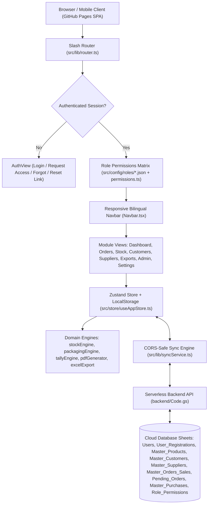

# Kaatha Wholesale (`కాతా హోల్‌సేల్`) — Documentation Hub

**Platform:** Kaatha CRM (`Mandi OS`) — Enterprise Rice & Groceries Wholesale Platform  
**Frontend:** React + TypeScript + Vite + Tailwind CSS + Zustand (`GitHub Pages` static SPA)  
**Backend & Database:** Serverless Web App (`backend/Code.gs`) backed by Google Sheets  
**Bilingual Support:** English (`EN`) & Telugu (`TE` / `కాతా`) with strict UI language isolation

---

## Documentation Index

| Document | Purpose |
| :--- | :--- |
| [Modules & Flowcharts](./MODULES_AND_FLOWCHARTS.md) | Detailed functional specifications and Mermaid flowcharts for every module in the codebase |
| [Sequential Change Log & Prompts](./CHANGE_LOG_AND_PROMPTS.md) | Chronological history of all user prompts, enhancements, files modified, and git commits |
| [Implementation Plan](./IMPLEMENTATION_PLAN.md) | Original master architecture and system design plan |
| [Requirements Specification](./REQUIREMENTS_SPEC.md) | Core business and functional requirements |
| [Setup Guide](./SETUP_GUIDE.md) | Deployment and backend webhook setup instructions |
| [Documentation Sync Rule](../.agents/rules/documentation-sync.md) | Automated workspace rule enforcing documentation & changelog updates on every change |

---

## High-Level System Architecture

---

## Codebase Module Map

| Area | Key Files |
| :--- | :--- |
| **App Shell & Routing** | `src/App.tsx`, `src/lib/router.ts`, `src/components/Navbar.tsx` |
| **State & Persistence** | `src/store/useAppStore.ts`, `src/contracts/index.ts`, `src/config/backend.ts` |
| **Authentication & Users** | `src/components/auth/AuthView.tsx`, `src/lib/crypto.ts`, `src/lib/jwt.ts`, `src/components/admin/UserRequestsView.tsx` |
| **Role Permissions** | `src/config/roles/roles.json`, `owner.json`, `admin.json`, `staff.json`, `customer.json`, `src/lib/permissions.ts`, `src/components/admin/RolePermissionsManager.tsx` |
| **Business Dashboard** | `src/components/dashboard/DashboardView.tsx` |
| **Orders & Dispatch** | `src/components/orders/PendingOrdersView.tsx`, `src/lib/stockEngine.ts` |
| **Stock & Packaging** | `src/components/stock/StockRegistryView.tsx`, `src/lib/packagingEngine.ts`, `src/lib/purchaseValidation.ts` |
| **Directories** | `src/components/customers/CustomerDirectoryView.tsx`, `src/components/suppliers/SupplierDirectoryView.tsx`, `src/lib/customerValidation.ts` |
| **Reports & Exports** | `src/components/exports/ExportCenterView.tsx`, `src/lib/pdfGenerator.ts`, `src/lib/excelExport.ts`, `src/lib/tallyEngine.ts` |
| **Settings, UI & Localization** | `src/components/settings/SettingsModal.tsx`, `src/components/ui/AlertDialog.tsx`, `src/hooks/useModalDismiss.ts`, `src/locales/en.ts`, `src/locales/te.ts`, `src/lib/bilingualHelper.ts` |
| **Backend & CI/CD** | `backend/Code.gs`, `.github/workflows/deploy.yml` |
| **Test Suites (Unit / UI / Backend / E2E)** | `tests/*.test.ts`, `tests/unit/`, `tests/ui/`, `tests/backend/`, `tests/e2e/` |
